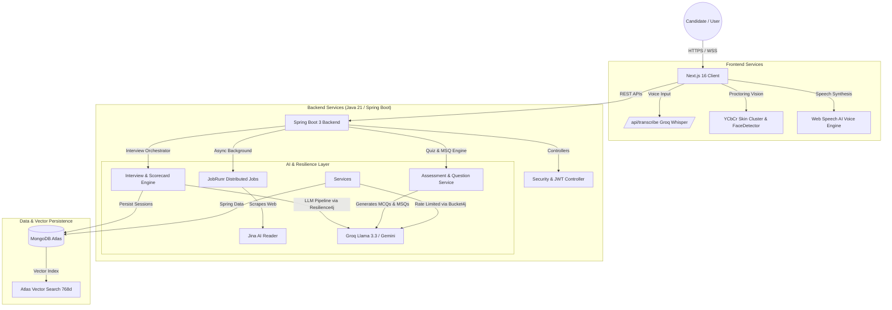

# NextLevel: Intelligent Knowledge & Career Operating System

NextLevel is a high-performance, enterprise-grade platform designed to consolidate digital information, accelerate technical learning, and conduct realistic AI-driven mock interviews. It leverages state-of-the-art AI orchestration, Spring Boot 3 microservices, MongoDB Atlas Vector Search, and resilient background processing to transform raw data into actionable knowledge and interview readiness.

---

## Problem and Solution

**The Problem:**
Information overload limits productivity. Engineers and students constantly gather links, notes, research papers, and documentation, yet finding and synthesizing this knowledge when preparing for high-stakes technical interviews or critical projects is chaotic. Traditional platforms separate knowledge capture from practice, offer rigid keyword searches, and lack automated workflows to evaluate technical competencies.

**The Solution:**
NextLevel introduces a unified **"AI-First" Knowledge and Career Architecture**:
1. **Intelligent Ingestion & Retrieval**: Ingests raw inputs (URLs, text, PDFs, DOCX), automatically parses content, creates 768-dimensional vector embeddings, and enables conceptual semantic search.
2. **Interactive Assessments (MCQ & MSQ)**: Automatically generates single-select and multiple-select questions (MSQs) with partial credit scoring from uploaded study materials.
3. **Proctored AI Mock Interviewer**: Voice-interactive technical interviewer grounded in your actual resume projects, complete with computer vision face proctoring, always-on Whisper speech transcription, and comprehensive hiring committee scorecards.

---

## System Architecture



---

## Technical Stack

NextLevel is built with modern engineering practices, resilience patterns, and strict typing.

### Backend (Core Services & API)
*   **Framework**: Java 21 / Spring Boot 3.3
*   **Architecture**: Multi-tier architecture (Controllers, Services, Repositories, DTOs)
*   **Background Processing**: JobRunr for durable, fault-tolerant asynchronous task execution
*   **Resilience & Rate Limiting**: Resilience4j (Circuit Breakers & Retries) and Bucket4j token-bucket rate limiters
*   **Security**: Spring Security 6, JWT Authentication, OAuth2 (Google), Method-level RBAC
*   **API Documentation**: SpringDoc OpenAPI (Swagger UI)

### Frontend (Client Application)
*   **Framework**: Next.js 16 (App Router, React 19)
*   **Audio & Speech Engine**: Native Web Audio API + Groq Whisper (`whisper-large-v3-turbo`) sub-300ms transcription
*   **Physics Engine**: Matter.js (2D rigid-body dynamics for Tech Arcade Bubble Pit)
*   **Computer Vision**: Client-side YCbCr Chromatic Skin Cluster Detection + Shape Detection API (`window.FaceDetector`)
*   **Styling & Design System**: Modern dark slate monochrome palette (`#08080a`, `#101014`, `#fafafa`), Vanilla CSS tokens, Framer Motion
*   **Data Visualization**: Recharts, 2D/3D Force-Directed Graphs (`react-force-graph`)

### Infrastructure & Database
*   **Database**: MongoDB Atlas (Document Store)
*   **Search**: MongoDB Atlas Vector Search (Cosine Similarity, 768 dimensions)
*   **AI Integration**: Spring AI (Groq API, Llama-3.3-70B, Google Gemini 2.5)

---

## Key Features

### 1. AI Mock Technical Interview Room
*   **Voice-Interactive AI Interviewer**: Humanoid SVG interviewer avatar with radiating soundwave animations, real-time mouth movement synchronization, and speech synthesis with configurable voices and playback speeds (0.9x – 1.15x).
*   **Resume Project Grounding**: Directly extracts candidate project titles, architectural components, and technical metrics from resumes (PDF, DOCX, TXT) to ask deep-dive system architecture and trade-off questions.
*   **Pre-Interview Hardware Calibration**: Preflight modal verifies camera and microphone permissions upfront, tests live audio levels with a responsive volume meter, and validates candidate presence before granting room access.
*   **Always-On Microphone (Groq Whisper)**: Hands-free answering without toggle buttons. Solves browser-specific speech limitations (including Brave's Google Speech block) via streaming `MediaRecorder` audio chunks to Groq Whisper (`whisper-large-v3-turbo`).
*   **Anti-Cheat Voice-Only Mode**: Completely removes textareas and keyboard typing to eliminate copy-pasted responses, ensuring authentic spoken technical articulation.
*   **Automated Proctoring (3-Infraction Rule)**:
    *   **YCbCr Skin Cluster Face Detection**: Chromatic segmentation identifies when the candidate leaves the frame (> 3.6s), distinguishing human subjects from walls, clothes, or covered lenses.
    *   **Window & Tab Blur Detection**: Detects application switching or tab minimization.
    *   **Warning System**: Issues audible alert chimes and warning toasts. Exactly 3 infractions automatically conclude the round and submit the scorecard.
    *   **Proctored Fullscreen & Escape Interception**: Auto-fullscreen mode with sidebar hidden; pressing Escape opens a prompt allowing the candidate to return to fullscreen or conclude their test.
*   **Staff-Level Hiring Scorecards**: Evaluates 5 core competencies (Technical Competence, Problem Solving & System Design, Communication Clarity, Resume Credibility, Confidence & Delivery) with verdicts (*Strong Hire*, *Hire*, *Leaning No Hire*, *No Hire*, or *Not Evaluated* for 0-answer sessions).

### 2. Assessment Hub with MSQ & MCQ Support
*   **Multiple Select Questions (MSQs)**: Full support for multi-correct question types alongside traditional single-select MCQs.
*   **Smart Scoring**: Provides partial scoring credit, correct/incorrect selection indicators, and granular explanations for each choice.
*   **Document-Driven Generation**: Ingests textbook excerpts, lecture slides, or technical documentation to automatically formulate rigorous evaluation sets.
*   **Exam Simulation & Timers**: Timed testing modes with review sessions and performance analytics.

### 3. Semantic Knowledge Retrieval
*   **Conceptual Search**: Employs vector cosine similarity to locate notes, concepts, and files based on semantic meaning rather than literal keyword matches.
*   **Embeddings Pipeline**: Powered by MongoDB Atlas Vector Search and Google `text-embedding-004` (768 dimensions).

### 4. Durable Asynchronous Workflows
*   **Automated Enrichment**: URLs and notes are asynchronously scraped (via Jina AI) and summarized (via Groq/Llama).
*   **Fault Tolerance**: JobRunr and Resilience4j ensure failed API calls are retried with exponential backoff while circuit breakers prevent cascading outages.

### 5. Spaced Repetition (SM-2) & Gamification
*   **Algorithmic Review**: Implements the SuperMemo-2 (SM-2) spaced repetition algorithm to optimize memory retention intervals based on recall ratings.
*   **Progression & Streaks**: XP engine awarding levels, badges, and study streaks for completing focus sessions and flashcards.

### 6. Collaborative Study Rooms & Multiplayer Arena (`/rooms`, `/rooms/[id]`)
*   **Animated Room Knock Loader (`RoomKnockLoader`)**: Atmospheric room transition upon joining or creating study rooms. Features an SVG figure knocking three times with live shockwave ripples on the door, progressing through 4 stages (`join` → `connect` → `sync` → `ready`). Once ready, the door swings open to spill warm amber light (`#f5a623`) onto the floor and halo glow onto the room before fading smoothly into the active space.
*   **Virtual Study Rooms**: Real-time collaborative focus spaces with unique 6-character room codes, shareable invitation links, and live participant presence tracking (Studying, Taking Break, In Sprint).
*   **Synchronized / Independent Focus Timer**: Customizable Pomodoro intervals (Focus 25m, Short Break 5m, Long Break 15m, Custom) with enlarged circular SVG progress gauges, audio chimes, and procedural ambient channels (Lo-Fi, Cafe, Rain, Ocean Waves).
*   **Real-Time Collaborative Room Chat & Scratchpad**: Low-latency WebSocket room messaging with timestamping, role badges, automated sprint alerts, and shared markdown collaborative scratchpads.
*   **Multiplayer Arena Game Modes**:
    *   *OA Blitz*: Timed competitive coding/MCQ sprint against peers with dynamic leaderboard rankings, speed bonuses, and reflex multipliers.
    *   *Survival Arena*: High-stakes sudden-death elimination round where incorrect answers transition players into spectator mode.
    *   *Squad Battle*: Team Alpha (Blue) vs Team Beta (Violet) aggregate squad competition.
    *   *Co-op Boss Battle*: Collaborative battle against the "Algorithmic Dragon" where correct answers deplete a shared boss HP pool.
*   **Proctored Sprint Shield**: Fullscreen enforcement, multi-monitor/tab-switch detection, automated proctoring strikes (kicking candidates at 3/3 violations), and instant room join-link revocation once a sprint commences.

### 7. Unified Minimal Monochrome Dashboard (`/dashboard`)
*   **Strict Design System Tokens**: Fully normalized CSS tokens (`--bg`, `--surface`, `--surface-2`, `--border`, `--border-strong`, `--text`, `--text-muted`, `--amber`, `--red`, `--green`, `--btn-bg`, `--btn-text`) eliminating rainbow inconsistencies.
*   **Dynamic Score Threshold Engine**: Color-coded performance feedback strictly tied to numerical mastery (< 40% `--red`, 40–70% `--amber`, > 70% `--green`).
*   **Daily AI Briefing**: Dynamic personalized briefings delivering high-yield motivational direction and direct planning shortcuts.
*   **Focus Today Circular Progress Ring**: Real-time visual tracking of daily study minutes against daily targets with amber progress fills.
*   **Instant Task Planner**: Inline single-click task entry directly on the dashboard with instant local and server synchronization.
*   **Multi-Vault Evaluation Feed**: Unified real-time assessment and mock interview evaluation feed with direct scorecard review links.

### 8. Comprehensive User Profile & Learning Analytics (`/profile`)
*   **Unified Activity Heatmap**: GitHub-style activity grid aggregating mock interviews, practice exams, deep focus sessions, and arena sprints across the calendar year.
*   **Arena & Room Participation**: Detailed stats tracking total rooms hosted, rooms attended, multiplayer sprints completed, and accumulated arena points.
*   **Inline Level & XP Progression**: Visual XP progress bar with level badges, showing exact XP progression and threshold targets for the next rank.
*   **Performance Score Velocity Graph**: Interactive Recharts area chart illustrating competency and test score trajectories over time.
*   **Resilient Fallback Architecture**: Client-side session hydration ensuring uninterrupted profile access even during backend cold starts.

### 9. Flow Suite: Focus Timer & Procedural Ambient Sound Engine (`/focus`)
*   **Spacious Deep Work Viewport**: Minimalist, distraction-free pure black interface (`#000000`) with generous card proportions, high-definition typography, and viewport-aware layout.
*   **Dynamic Stars Galaxy Canvas**: When a focus session begins, the background dynamically transitions into a meditative 3D starfield galaxy drifting at slow speeds to encourage cognitive flow.
*   **Customizable Intervals**: Instant presets for classic 25m Pomodoro, 5m Zen Breaks, 15m Long Breaks, or custom sessions (1–120 minutes) with real-time SVG progress rings.
*   **Procedural Web Audio Synthesizers**:
    *   *Binaural Beats*: Dual sine oscillator tone generation (100 Hz left, 104 Hz right) blended with low-pass Brownian noise to stimulate theta-wave focus.
    *   *Relaxing Rain Synth*: Real-time parameterized stochastic raindrop clicks modulated across randomized bandpass filters.
    *   *Warm Brownian Noise*: Deep ocean-like Brownian noise buffer generator scaled for acoustic shielding.
    *   *Wooden Metronome*: Triangle-wave acoustic click scheduler.
*   **Task Linkage & Automated XP Rewards**: Connect active focus blocks directly to daily planner items; auto-persists completed study sessions to the backend and grants XP gamification rewards.

### 10. Flow Suite: Tech Arcade Physics Sandbox (`/arcade`)
*   **2D Rigid-Body Dynamics (Matter.js)**: Full-viewport physics playground running at 60 FPS with boundary collision walls, variable restitution, and friction tuning.
*   **Glassmorphic Tech Spheres**: Volumetrically rendered tech spheres representing 14 modern engineering frameworks (React, Next.js, Node, TypeScript, JavaScript, Python, Docker, Java, Git, PostgreSQL, AWS, Rust, GraphQL, Linux) with dynamic specular rim lighting and highlight shaders.
*   **Clean Startup & User Interaction**: Starts cleanly with zero initial spheres; bubbles spawn dynamically via canvas clicks or manual `+ Spawn` triggers.
*   **Cursor Air-Pressure Interaction**: Hovering and flicking the cursor exerts continuous radial air pressure on nearby spheres, creating fluid wave motion without requiring mouse clicks.
*   **Dynamic Gravity Control**: Instant gravity state switching between 1G Normal, 0G Space floating, and Anti-G inverted gravity with in-place physics updates.

### 11. Flow Suite: Cosmic Portal (`/portal`)
*   **Interactive Dimensional Fracture**: Fullscreen canvas experience with nebula storms, stardust flows, and rotating dimensional rings.
*   **5 Neon Spectrum Dimensions**: Cycle through Deep Violet, Electric Purple, Cosmic Blue, Blazing Cyan, and Neon Teal dimensions on click.
*   **Shockwave Explosions**: Clicking anywhere triggers an electric shockwave ring and particle explosion that scatters stardust outwards with realistic damping.

### 12. Interactive Knowledge Graph & Visual Topography
*   **Force-Directed 2D Graph**: Visual topography mapping conceptual connections between isolated captures and notes.
*   **Interactive 404 Experience**: Dedicated interactive ghost canvas following cursor physics with audio toggles and instant recovery shortcuts.

---

## Getting Started

### 1. Prerequisites
*   **Java 21** & **Maven 3.9+**
*   **Node.js 18+** & **npm**
*   **MongoDB Atlas** cluster with Vector Search enabled
*   **API Keys**: Groq API Key, Google Gemini API Key

### 2. Repository Setup

```bash
git clone https://github.com/Animesh-86/NextLevel.git
cd NextLevel
```

### 3. Backend Setup

Configure environment variables in `backend-spring/src/main/resources/application.yml` or via a `.env` file in the root directory:

```env
MONGODB_URI=mongodb+srv://<user>:<password>@cluster.mongodb.net/nextlevel?retryWrites=true&w=majority
GROQ_API_KEY=your_groq_api_key
GEMINI_API_KEY=your_gemini_api_key
GOOGLE_CLIENT_ID=your_oauth_client_id
GOOGLE_CLIENT_SECRET=your_oauth_client_secret
JWT_SECRET=your_secure_jwt_secret
PORT=8080
```

Build and launch the Spring Boot application:

```bash
cd backend-spring
mvn clean install -DskipTests
mvn spring-boot:run
```

The Spring Boot API will start on `http://localhost:8080`.

### 4. Frontend Setup

In a separate terminal, navigate to `frontend` and install packages:

```bash
cd frontend
npm install
```

Configure `.env.local` in `frontend/`:

```env
NEXT_PUBLIC_API_URL=http://localhost:8080
GROQ_API_KEY=your_groq_api_key
GEMINI_API_KEY=your_gemini_api_key
MONGODB_URI=mongodb+srv://<user>:<password>@cluster.mongodb.net/nextlevel
AUTH_SECRET=your_auth_secret
NEXTAUTH_URL=http://localhost:3000
```

Start the Next.js development server:

```bash
npm run dev
```

Open `http://localhost:3000` in your browser.

---

### 5. Vector Search Index Configuration

In the MongoDB Atlas web console, create an **Atlas Vector Search Index** on the `captures` collection using the following JSON definition:

```json
{
  "fields": [
    {
      "numDimensions": 768,
      "path": "embedding",
      "similarity": "cosine",
      "type": "vector"
    }
  ]
}
```

---

## API Documentation

When the backend server is running, the interactive OpenAPI documentation and Swagger UI are accessible at:
*   **Swagger UI**: `http://localhost:8080/swagger-ui.html`
*   **OpenAPI JSON**: `http://localhost:8080/v3/api-docs`

---

## Testing Key Features

| Feature | Route / Endpoint | Description |
| :--- | :--- | :--- |
| **AI Mock Interview** | `/interview` | Hardware preflight calibration, resume grounding, always-on Whisper STT, proctoring |
| **Scorecard Review** | `/interview/[id]/scorecard` | 5-competency breakdown, verdict, question-by-question model answers |
| **Study Rooms & Arena**| `/rooms` or `/rooms/[id]` | Collaborative focus rooms, Boss Battles, OA Blitz, Squad Battles, proctored sprints |
| **Dashboard** | `/dashboard` | Dynamic Daily AI Digest, Focus Today ring, inline task planner, velocity cards |
| **User Profile & Stats**| `/profile` | Activity heatmap across all tasks, arena stats, performance score graphs, XP leveling |
| **Focus Timer** | `/focus` | Dedicated Pomodoro timer with dynamic slow-drifting Stars Galaxy canvas & binaural sound |
| **Tech Arcade** | `/arcade` | Matter.js 2D physics bubble sandbox with cursor air pressure dynamics and gravity modes |
| **Cosmic Portal** | `/portal` | Interactive dimensional fracture canvas with stardust explosions and 5 neon spectrums |
| **Focus Tests (MSQ/MCQ)**| `/test` | Timed assessments with tab-switching proctoring, escape interception, and MSQ support |
| **Planner & Workspaces** | `/workspace` | Daily goal tracking, task linkage, SM-2 flashcard review, and study analytics |
| **Capture Hub** | `/captures` | URL scraping via Jina AI, note ingestion, and semantic vector search |
| **Files & Links** | `/library` | Document upload, text extraction, resume parsing, and content indexing |
| **Interactive 404** | `/404` or `/non-existent` | Interactive black ghost canvas with audio toggle |

---

*Maintained by Animesh Sharma*
